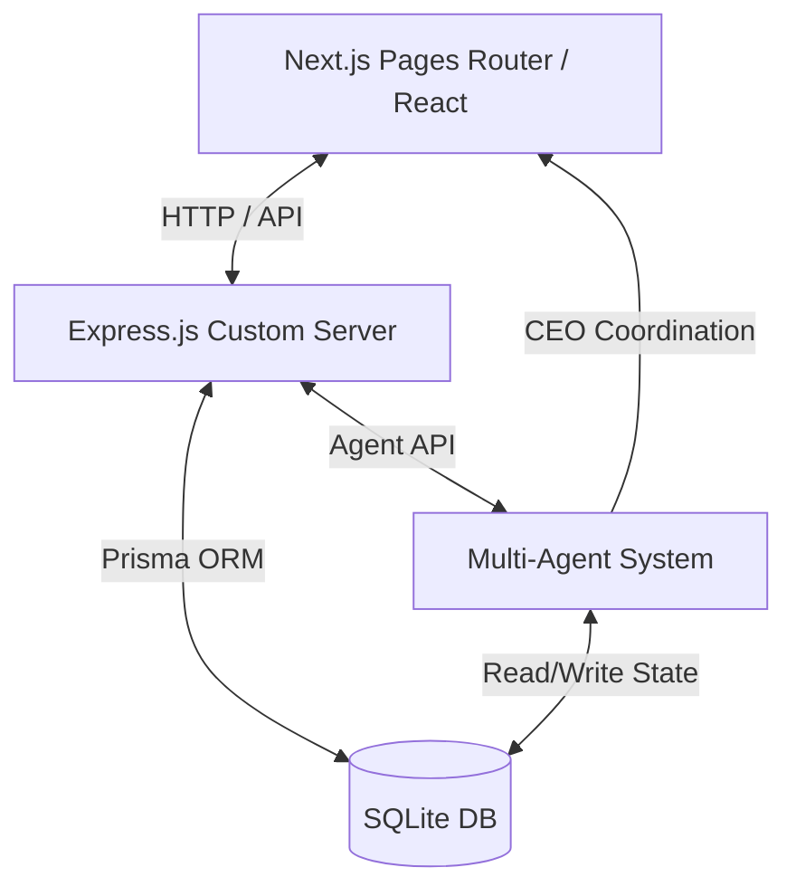

# AI College Operating System (AI-COS)

AI-COS is a premium, startup-quality, all-in-one student operating system designed to automate academic life. It is built as a **local-first** application with zero external cloud dependencies, requiring no API keys. Coordinated by **11 local AI agents**, AI-COS audits attendance skip margins, schedules assignments, calculates grade forecasts, tracks LeetCode practice, organizes markdown notes, and runs mock interviews.

---

## Architecture Diagram



---

## Folder Structure

The project has been fully modularized:
*   `server.ts`: Custom Next.js + Express.js unified server runner.
*   `src/backend/`: Express.js authentication, dashboard, and module controllers.
*   `src/database/`: SQLite database file (`dev.db`) and Prisma Schema definitions.
*   `src/agents/`: Local rule-based AI agent modules (CEO, Attendance, Assignment, Exam, etc.).
*   `src/components/`: Reusable React components (collapsible Sidebar, layout wrappers).
*   `src/hooks/`: Custom hooks like `useAuth`.
*   `src/lib/`: Setup files for database client and auth context.
*   `src/pages/`: Next.js frontend pages (Landing, About, Dashboard, Tracker modules).
*   `src/styles/`: Global dark glassmorphism stylesheet.
*   `src/utils/`: Security password hashing utilities.

---

## Features

1.  **CEO Agent Briefing Panel**: Dynamic notifications displaying consolidated briefings.
2.  **Attendance Auditor**: Predicts skip limits and needed presence tallies to maintain 75%.
3.  **Assignment Scheduler**: Ranks task priorities and outlines study hours calendars.
4.  **Exam revision tracker**: Countdown clocks, syllabus checklists, and prep score forecasts.
5.  **Kanban Project Board**: Manages task checklists, recalculates project completion percentages.
6.  **Placement DSA & Job Logs**: Solved LeetCode counters and application pipelines (applied, interviews, offers).
7.  **Career Path trees**: Selecting paths (AI, Software, Cloud) loads skills lists and recommended courses.
8.  **CGPA Simulator**: Projects semester GPAs and details GPA needed for graduation targets.
9.  **Pomodoro Timer**: Functional deep focus study tracker that logs sessions to SQLite.
10. **Markdown notebook**: Organize notes by custom folders and stars bookmarks.

---

## How to Run

Follow these steps to spin up the local operating system on your machine:

### 1. Install Dependencies
```bash
npm install
```

### 2. Synchronize SQLite Database
Generate the local Prisma Client and build the SQLite database file:
```bash
npx prisma generate --schema=src/database/schema.prisma
npx prisma db push --schema=src/database/schema.prisma
```

### 3. Launch Development Server
Launch the unified custom server on port 3000:
```bash
npm run dev
```
Open **[http://localhost:3000](http://localhost:3000)** in your browser.

---

## Future AI Integration (Gemini & Google ADK 2.0)

AI-COS is engineered with a clean decoupled design, making it fully ready for future AI capabilities:

### Integrating Google Gemini API
Instead of rule-based logic inside `/src/agents/`, you can call the Gemini API using the official SDK:
```typescript
import { GoogleGenAI } from "@google/genai";

const ai = new GoogleGenAI({ apiKey: process.env.GEMINI_API_KEY });

// Replace rule-based logic in placement.ts with Gemini evaluation
const response = await ai.models.generateContent({
  model: 'gemini-2.5-flash',
  contents: `Evaluate this student's DSA answer: ${answer}. Expected question: ${question}`,
});
```

### Plugs in Google ADK 2.0
The agent structure in `src/agents/` is structured as pure function handlers mapping databases to suggestions. When integrating with Google ADK 2.0:
1.  Define the database schemas as **tools** that ADK can call.
2.  Register the 11 agents as **specialized ADK task executors**.
3.  Let the CEO Agent act as a **Router/Supervisor Agent** managing sub-agent tasks and coordinating prompt context arrays.
